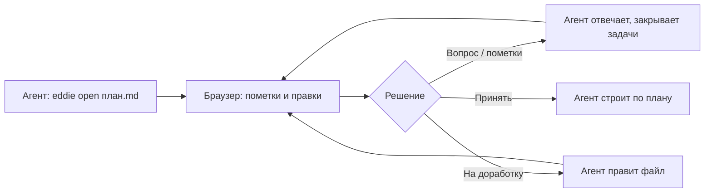

# Eddie — свой канвас для ревью планов и отчётов

_Дизайн-док v3, 2026-07-21. Статус: v2 принята Гошей (Approve в канвасе); v3 — три дополнения по ходу стройки: редактор сразу при выделении, правки в HTML, подсветка изменений агента._

> **Что проверять в этом обновлении**
>
> - 🆕 **НОВОЕ** — раздел «Задачи и история»: каждая пометка = задача со статусом, агент их закрывает (по твоим пометкам про Хистори и Задачи)
> - 🆕 **НОВОЕ** — фича «Предложить правку»: формулировки правишь редактором прямо в канвасе, не промтом (по твоей пометке на диаграмме)
> - 🔧 **ИСПРАВЛЕНО** — кнопки отправки переосмыслены: один блок из трёх действий с ответом «какую когда жать»
> - 🔧 **ИСПРАВЛЕНО** — «End session» → «Хендофф в чат»; про порт уточнено (да, у всех юзеров); тумблер пометок — включён по умолчанию, так и было
> - 👀 **ПРОВЕРИТЬ** — раздел «Задачи и история»: так ли ты это видел
> - ℹ︎ **ИЗВЕСТНО** — код ещё не написан; после Approve — план реализации

## Зачем

Сейчас канвас для ревью живёт внутри чужого клона ECC (`~/ecc`), который сам обновляется по понедельникам: править его нельзя (снесёт апдейтом), интерфейс английский и не всё в нём очевидно. Выносим движок в свой отдельный проект **Eddie**: репо под `2dryhands`, полная свобода правок, русский интерфейс, свой бренд — и можно шерить.

Лицензия позволяет: у ECC MIT, в README и LICENSE оставляем строку-благодарность автору оригинала (Affaan Mustafa, everything-claude-code; тот в свою очередь вдохновлялся lavish-axi).

## Что такое Eddie в одном абзаце

Агент пишет план или отчёт, открывает его тебе в браузере и встаёт на паузу. Ты тыкаешь в конкретные места документа, оставляешь пометки или сразу правишь формулировки, всё копится в очередь и уходит агенту одной пачкой вместе с решением: «Принять», «На доработку» или просто вопросом. Каждая пометка становится задачей со статусом — видно, что агент уже поправил, а что ещё висит. Весь фидбек приходит агенту структурным JSON — ничего не теряется и не пересказывается своими словами.



## Что можно ревьюить

- **Markdown** (`.md`) — Eddie красиво рендерит сам: заголовки, таблицы, код, mermaid-диаграммы.
- **HTML** (`.html`) — показывается как есть, тыкалка работает поверх: любой дашборд, отчёт, превью.

Точность прицела — три уровня, во всех агент получает точную привязку (селектор + цитата):

1. **Зона**: наводишь мышь — блок подсвечивается рамкой, клик — пометка ко всему блоку.
2. **Слова**: выделяешь текст мышью — кнопка «Пометить выделенное», коммент к конкретной фразе.
3. **Правка** 🆕: выделяешь фразу — карточка открывается **сразу**, без промежуточных кнопок: выделенный текст уже в редакторе, правишь как надо; ниже — необязательное поле комментария. Изменил текст — агенту уходит пара «было → стало» (+комментарий, если есть), агент применяет замену дословно. Не менял текст, только комментарий — уходит обычная пометка. Работает одинаково в md и в HTML-артефактах.

## Подсветка изменений агента 🆕

После того как агент поправил документ по твоим пометкам, при перезагрузке страницы изменённые и новые блоки подсвечиваются цветом (жёлтый фон + полоса слева) — сразу видно, что именно поменялось с момента твоей последней отправки фидбека. Механика: в момент отправки фидбека канвас запоминает тексты всех блоков документа; после правок агента блоки, которых не было в том снимке, помечаются. Чисто клиентская фича, работает и для md, и для html; следующая отправка фидбека сбрасывает точку отсчёта.

## Структура репо

```
eddie/
├── eddie.js          # CLI: open / await / end / stop / server
├── lib/
│   ├── server.js     # HTTP-сервер на 127.0.0.1, наружу не торчит
│   ├── sessions.js   # сессии, задачи и их статусы
│   ├── ui.js         # браузерный интерфейс
│   ├── sdk.js        # скрипт-«тыкалка», внедряется в документ
│   ├── markdown.js   # рендер md → html
│   ├── i18n.js       # словари ru/en
│   └── loopback-guard.js  # защита от чужих хостов
├── tests/            # перенесённые тесты ECC + новые
├── SKILL.md          # скилл для Claude Code
├── README.md         # RU + EN, гифка с демо
├── LICENSE           # MIT + attribution
└── package.json      # bin: "eddie", zero dependencies
```

Технически: чистый Node, **ноль npm-зависимостей**. Единственное внешнее — Mermaid с CDN для диаграмм (опционально, без сети диаграмма остаётся текстом).

Отвязка от ECC:

- переменные окружения `ECC_PLAN_CANVAS_*` → `EDDIE_*`;
- **порт по умолчанию 4519 — у всех, кто поставит Eddie** (меняется через `EDDIE_PORT`). Число выбрано в стороне от ECC-версии (4517), чтобы у тех, у кого стоят обе, они жили мирно;
- своя папка состояния (`~/.eddie/`), сессии ECC не трогаем.

## Интерфейс: что меняем

**Язык.** Два словаря (ru/en), язык берётся из браузера автоматически, в шапке переключатель RU/EN, выбор запоминается.

**Отправка — один блок вместо двух.** Сейчас кнопки вердикта живут сверху, «Send to agent» снизу, и непонятно, какую когда жать. Делаем один блок внизу, под полем сообщения, три действия рядом:

| Кнопка | Когда жать | Что делает агент |
|---|---|---|
| 💬 Отправить (N) | Есть вопросы или пометки, но итог подводить рано | Отвечает, правит по пометкам, закрывает задачи — ревью продолжается |
| 🔧 На доработку (N) | Посмотрел всё, нужна новая версия целиком | Правит документ, страница сама обновляется |
| ✅ Принять (N) | План устраивает | Идёт делать по плану |

Все три отправляют одно и то же — накопленные пометки + текст из поля. Разница только в сигнале агенту, что делать дальше. Счётчик (N) на каждой кнопке показывает, сколько пометок уедет. Это и есть ответ на «какую из них когда нажимать» — и он будет написан в шпаргалке прямо в интерфейсе.

**Онбординг в пустой панели.** Мини-шпаргалка: «1. Кликни в любое место документа или выдели текст → пометка. 2. Пометки копятся и не улетают сразу. 3. Любая из трёх кнопок отправляет всё разом — выбирай по смыслу: вопрос / на доработку / принять».

**Тумблер «Пометки»** — включён по умолчанию (как и сейчас), выключаешь только если надо покликать по самому документу (ссылки, интерактив). Cmd+I.

**«End session» → «Хендофф в чат».** Смысл кнопки не «убить сессию», а «я закончил тыкать — продолжаем в чате»: агент получает сигнал, забирает неотправленное и дорассказывает всё в чате Claude Code. Переименовываем и в тултипе так и пишем.

**Бренд.** Логотип-градиент с буквой **E**, заголовок «Eddie», favicon той же буквой. Палитру оригинала оставляем — тёмная/светлая темы уже есть.

## Задачи и история 🆕

Сейчас отправленная пометка растворяется в чате — непонятно, что агент с ней сделал. Меняем модель: **каждая отправленная пометка/правка = задача** с жизненным циклом.

- Статусы: **⏳ у агента** (отправлена) → **✅ сделано** / **💬 отвечено** (для общих вопросов) / **🚫 отклонено** (агент объяснил, почему нет).
- Агент закрывает задачи через CLI: `eddie await <файл> --resolve fb-12:"перенёс блок наверх" --resolve fb-13:"ответил в чате"`. Ленивый агент, который просто ответил `--reply` без резолва, задач не закрывает — они остаются висеть, и это видно.
- В панели — секция **«Задачи»**: активные сверху, закрытые сворачиваются в **историю** с пометкой, что именно сделано. Клик по задаче подсвечивает её место в документе.
- Задачи хранятся в состоянии сессии на диске — переживают перезагрузку страницы и рестарт сервера.
- В JSON для агента ничего не ломается: те же items, у каждого уже есть id — резолв просто ссылается на него.

## Скилл и локальная миграция

- В репо — `SKILL.md` на английском (для шеринга): `eddie open <файл>` → `eddie await <файл>` (в фоне) → JSON → правки → `--reply`/`--resolve`. Плюс требования к артефактам: плашка «Что проверять в этом обновлении» сверху, никакого auto-refresh, бейзлайн первым в сравнениях.
- Локально `~/.claude/skills/plan-canvas/` → `~/.claude/skills/eddie/`: обёртка переписывается на Eddie, триггеры «открой в канвасе» / «дай покомментировать» сохраняются. Старый скилл удаляем, чтобы не было двух канвасов.
- `~/ecc` не трогаем вообще.

## Критерии успеха — до кода

1. **Перенесённые тесты зелёные**: `npm test` в репо Eddie (в ECC ~700 строк готовых тестов, чистый Node, забираем и адаптируем).
2. **i18n-selftest**: каждый ключ есть в обоих словарях, пустых строк нет — иначе красный.
3. **E2E-смоук**: `eddie open demo.md` → сервер строго на 127.0.0.1:4519 → POST фидбека → `await` вернул корректный JSON → `--resolve` закрыл задачу → статус виден в API → `end`.
4. **Тест задач**: пометка → отправка → задача «у агента» → резолв → «сделано» с текстом; перезапуск сервера — статусы на месте.
5. **Тест правок**: «Предложить правку» уходит как `{kind:"edit", было, стало, anchor}`; selftest проверяет формат.
6. **Человеческий тест**: прогоняю сам через браузер (Playwright) — пометка зоны, выделение слов, инлайн-правка, три кнопки отправки, RU/EN, хендофф. Скриншоты покажу.
7. **Совместимость**: ECC-канвас на 4517 и Eddie на 4519 живут одновременно.

## Этапы

1. **Экстракция как есть** — новый репо, перенос, переименование, порт, env; тесты зелёные. Никаких правок UI. (Отдельный коммит — чистая точка отката.)
2. **i18n + блок отправки + онбординг + хендофф** — словари, три кнопки со счётчиком, шпаргалка.
3. **Задачи и история + «Предложить правку»** — протокол резолва, панель задач, инлайн-редактор.
4. **SKILL.md + README + демо** — упаковка, локальная миграция скилла.
5. **Приёмка**: показываю живой Eddie в нём же самом. После твоего «ок» — репо публичным.

Репо создаём **приватным**, публичным делаем после приёмки.

## Открытые вопросы

1. **Хоткей вердикта**: Cmd+Enter в чате = «Отправить», Cmd+Shift+A = «Принять»? Дёшево, но можно и без него.
2. **Имя npm-пакета**: `eddie` на npm почти наверняка занято — публикуем пока только на GitHub (`npx github:2dryhands/eddie`), npm отложить?
3. **Сессия-лист** (страница `/` со списком ревью): русифицировать сразу — предлагаю да, там три строчки.
